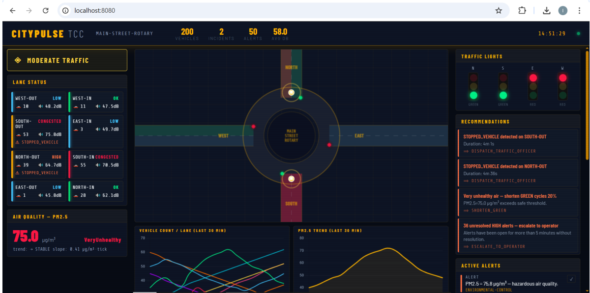

# 🚦 Smart Urban Traffic Management System (MAIN-STREET-ROTARY)

> **Distributed Systems & Event-Driven Architecture Project**  
> A real-time, multi-protocol Smart City simulation platform designed for urban roundabout supervision, event streaming, automated congestion analysis, and traffic light orchestration.

---

## 📋 Executive Overview

Modern smart cities require seamless integration of heterogeneous sensors deployed across critical urban intersections. The **MAIN-STREET-ROTARY** project models a busy 4-axis downtown roundabout monitored by 29 distinct sensors and actuators.

The system addresses four key engineering challenges:
1. **Heterogeneous Data Ingestion:** Collecting data across 5 distinct communication protocols adapted to sensor constraints.
2. **Event Streaming:** Centralizing high-frequency time-series streams using **Apache Kafka**.
3. **Automated Analytics:** Detecting traffic congestion, noise peaks, and pollution warnings via a multi-strategy engine.
4. **Real-Time Visualization:** Streaming live telemetry and roundabout maps to a web dashboard via WebSockets.

---

## 🏛️ System Architecture

The project follows a 4-Layer Distributed System Pattern:

```text
┌────────────────────────────────────────────────────────────────────────┐
│                   Layer 4: Real-Time Web Dashboard                     │
│               (Spring Boot + WebSockets / Live Map UI)                 │
└────────────────────────────────────────────────────────────────────────┘
                                    ▲
                                    │ WebSocket Stream
┌────────────────────────────────────────────────────────────────────────┐
│               Layer 3: Analytics Engine & Processing                   │
│        (Congestion Analysis, EPA Pollution Rules, Action Engine)       │
└────────────────────────────────────────────────────────────────────────┘
                                    ▲
                                    │ Partitioned Consumer
┌────────────────────────────────────────────────────────────────────────┐
│                  Layer 2: Message Bus & Persistence                    │
│            (Apache Kafka Unified Topic + MySQL Time-Series DB)         │
└────────────────────────────────────────────────────────────────────────┘
                                    ▲
                                    │ Unified JSON Payload (Producer)
┌────────────────────────────────────────────────────────────────────────┐
│                  Layer 1: Heterogeneous Sensor Services                │
│  [JAX-WS SOAP]    [JAX-RS REST]    [Java RMI]    [TCP Sockets]  [JAX-RPC]│
│  Vehicle Flow     Air Quality     Camera Scan    Noise Stream  Traffic Light│
└────────────────────────────────────────────────────────────────────────┘
```


📡 Sensor Network & Distributed ProtocolsEach equipment type in the 29-device rotary inventory uses an optimal distributed communication protocol:Service / EquipmentProtocol / TechQtyJustification & RoleVehicle Flow SensorsJAX-WS (SOAP)8Strict WSDL contract for structured lane entry/exit vehicle counts.Pollution SensorJAX-RS (REST)1Lightweight HTTP/JSON API for PM2.5 readings & EPA AQI classification.Surveillance CamerasJava RMI8Remote method invocation (scan()) for real-time incident detection.Acoustic SensorsTCP Sockets8Low-level streaming socket connection on Port 9000 for continuous decibel tracking.Traffic Light ActuatorsJAX-RPC4Remote procedure calls for microsecond-level signal phase switching (Phase A/B).


## ⚙️ Core Components & Technical Details1.
### Data Transport & Storage (Apache Kafka & MySQL)Kafka Bus:
Aggregates multi-source sensor streams into a unified JSON event stream.Database Partitioning (traffic_db): High-volume telemetry tables (traffic_snapshots, lane_readings, pollution_readings) are partitioned monthly via PARTITION BY RANGE.
Zero-Downtime Purge: Automated 7-day retention cleanup using ALTER TABLE DROP PARTITION executing in $O(1)$ time without locking active tables.2. 
### Multi-Strategy Analytics
EngineThe CongestionAnalyser runs continuous analysis across a 5-minute sliding window:Instantaneous Thresholds: Triggers alerts when lane flux exceeds high density.
Linear Trend Analysis: Calculates least-squares regression slopes on vehicle arrival rates.Persistence Verification: Confirms congestion if sustained across $\ge 3$ consecutive cycles.
Spillback Detection: Identifies blocked exit lanes propagating back into the roundabout.
Zone-Wide Saturation: Detects gridlock when $\ge 50\%$ of lanes are simultaneously congested.3. 
### Air Quality Index (AQI)
CategorizationThe pollution service tracks PM2.5 ($\mu g/m^3$) based on EPA standards:$\le 12$ Good: Normal operations.$12 - 35$ Moderate: Standard monitoring.$35 - 55$ Unhealthy: Level-MEDIUM alert.$55 - 150$ Very Unhealthy: Level-HIGH alert + traffic flow reduction recommendations.$> 150$ Hazardous: CRITICAL alert + immediate signal redirection.

## 🛠️ Tech StackLanguage:
Java (JDK 8 / 11+)Distributed Services: JAX-WS, JAX-RS, Java RMI, Native Java TCP Sockets, JAX-RPCMessaging & Streaming: Apache Kafka, ZookeeperDatabase: MySQL (Partitioned InnoDB tables)Backend Framework: Spring Boot, Spring WebSocketsBuild Tools: Apache Maven / Gradle🚀 Getting StartedPrerequisitesJava JDK 11 or higherApache Kafka & ZookeeperMySQL 8.0+Setup & ExecutionClone the repository

cd your-repo-name
Database Setup:
Import the schema into your MySQL instance:Bashmysql -u root -p < database/schema.sql
Start Apache Kafka:Bash# Start Zookeeper
zookeeper-server-start.sh config/zookeeper.properties

# Start Kafka Broker
kafka-server-start.sh config/server.properties
Build and Run Services:Bashmvn clean package
java -jar target/smart-traffic-system.jar
Access the Dashboard:
Open http://localhost:8080 in your browser to view the real-time roundabout map and analytics telemetry.

<p align="center">
  
</p>


